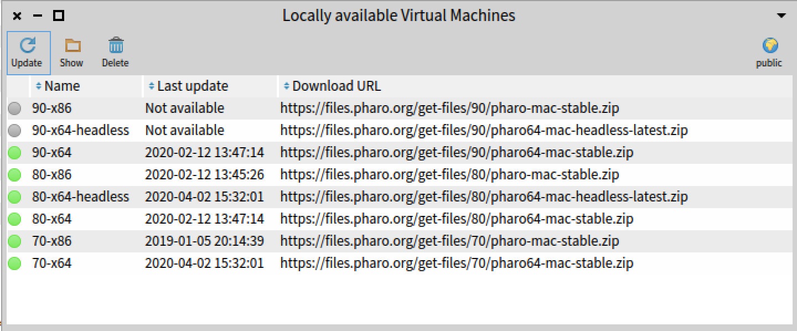
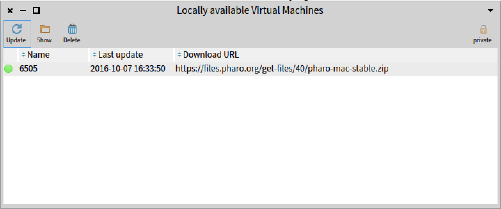

The Virtual Machine manager is available from the **VMs** button of the main toolbar.
It shows the list of default Virtual Machines (e.g. most used VMs) as well as the Virtual Machines already available locally for Pharo Launcher, with their version and status:

* *Up to date*: the last check found no newer archive on the server,
* *Update available*: a newer archive of this virtual machine is published,
* *Custom VM*: a virtual machine you installed yourself; Pharo Launcher does not update it,
* *Not installed*: the virtual machine is not available locally yet,
* *Not checked*: no check was done yet for this virtual machine.

Select a virtual machine to see its details below the list: its download URL, its location on disk (click it to open the folder), when it was installed and its status.

## Updates

Pharo Launcher checks at startup, then once a day, if a newer archive is published for the installed virtual machines (needs internet access, see the *Check for virtual machines update?* setting).
When updates are available, a red badge with their number is shown on the **VMs** button of the main toolbar. Nothing is updated without your action.

Open the Virtual Machine manager: the virtual machines to update are selected. Click on the **update** button to download and install them.
Selected virtual machines already up to date are skipped, and a non-available virtual machine is downloaded.
A virtual machine that cannot be updated (e.g. on Windows, when an image is running on it) is left as it was, and reported. Close the images running on a virtual machine before updating it.

## Private virtual machines

A click on the private button will toggle the view between:

* the list of VMs used by Pharo Launcher to launch Pharo images,
* the list of VMs used by Pharo Launcher to determine the Pharo version of images (indeed, we must run the image to get its Pharo version number if not found in metadata aside the image).

vms-presenter-private.png
